# Design: teams apart from tournaments (#353)

!!! warning "Not built yet"
    This page is the agreed plan from the #353 grilling session.
    Terms follow `GLOSSARY.md` (Team, Temporary team, Lasting team,
    Tournament entry, Lineup, Tournament post).

## What goes where

A Team is its own cog. The tournament cog and the voice split use it; nothing uses the tournament cog.
A tournament belongs to one guild, which can run several at once. It is tied to no channel. Teams belong to no guild.

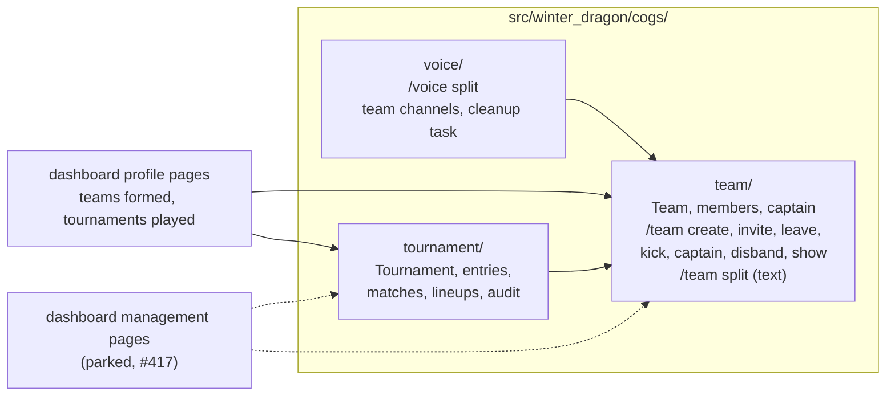

## Data model

Tables and the links between them. Column names are indicative; the migration settles them.

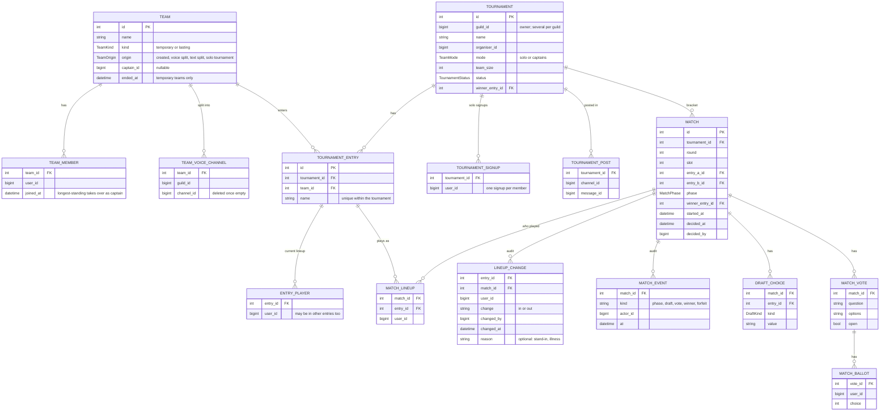

What changes compared to today's tables:

- `Tournament` keeps `guild_id` and loses `channel_id`. The one-active-tournament-per-guild rule goes. A tournament is found by name or id, not by channel.
- `TournamentTeam` becomes `TOURNAMENT_ENTRY` and points at a `TEAM`. The captain moves to the team.
- `TournamentPlayer` splits three ways. A solo signup becomes `TOURNAMENT_SIGNUP`. An entry's current players become `ENTRY_PLAYER`. Who played each match goes in `MATCH_LINEUP`.
- A member can be in several entries of one tournament, so `ENTRY_PLAYER` has no one-entry-per-member key.

## Team lifecycle

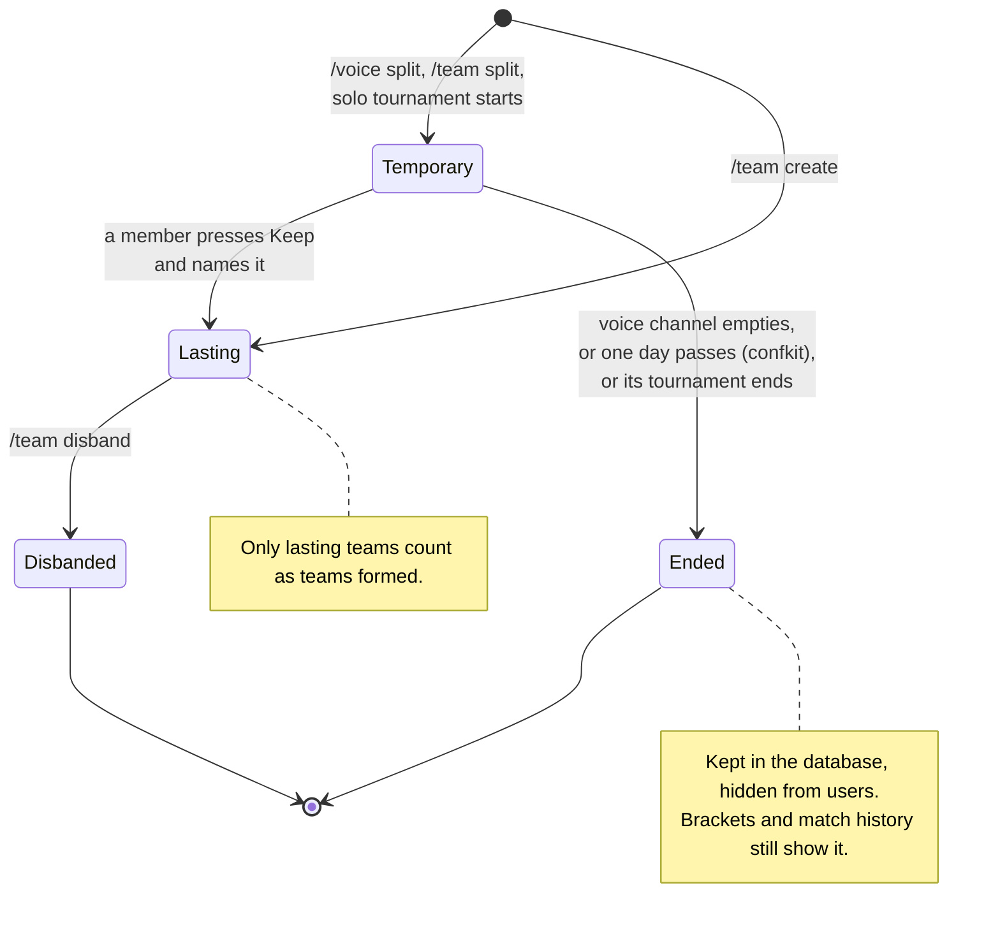

Captain rules for a lasting team:

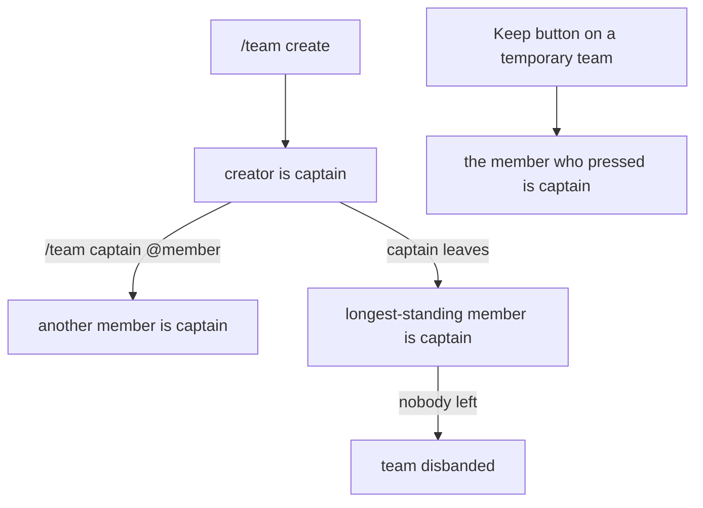

A temporary team has no captain, except a solo tournament's, where the first player drawn captains it.

## Splitting into temporary teams

`/voice split` takes the caller's voice channel and posts the teams in that channel's chat. Each player presses Move to be moved, so nobody is moved without agreeing and the caller needs no Move Members permission. With `move=False` the post has no Move button. `/team split` takes members picked in a user select.

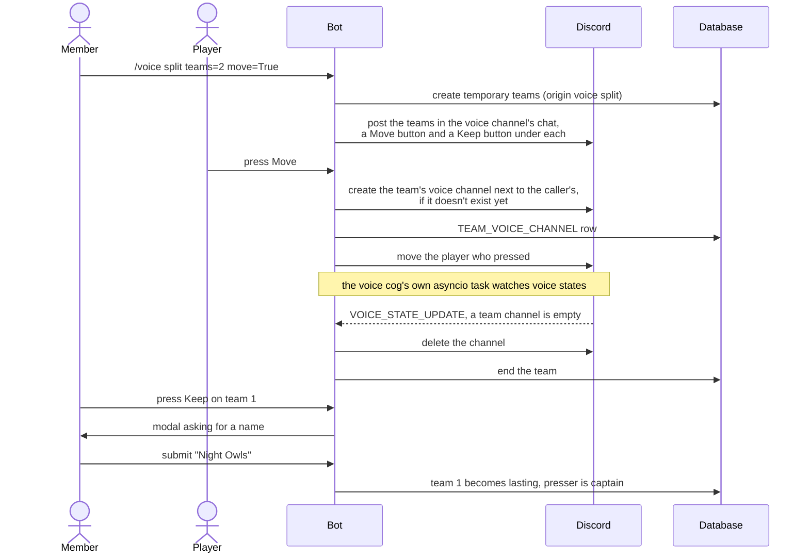

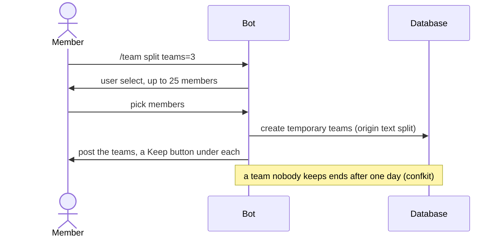

## Tournament and match flow

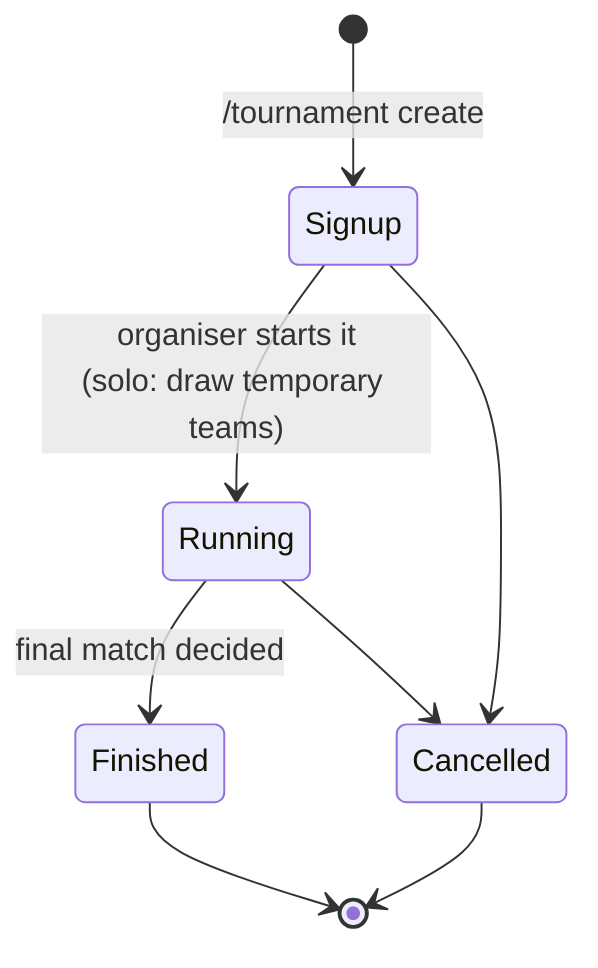

A match copies its lineups from the entries when it becomes ready. A member who is in both lineups blocks the match until someone drops them from one side.

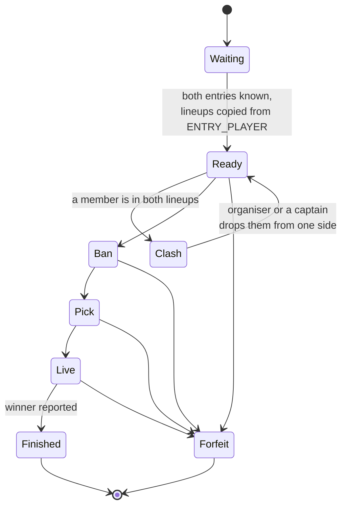

## Lineup changes carry forward

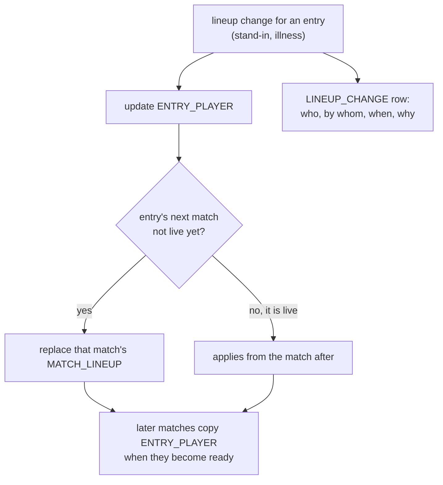

Decided matches keep their `MATCH_LINEUP` as it was, so match history shows who played.

## Migration

No tournaments run in production, so the migration can reshape the tables freely.

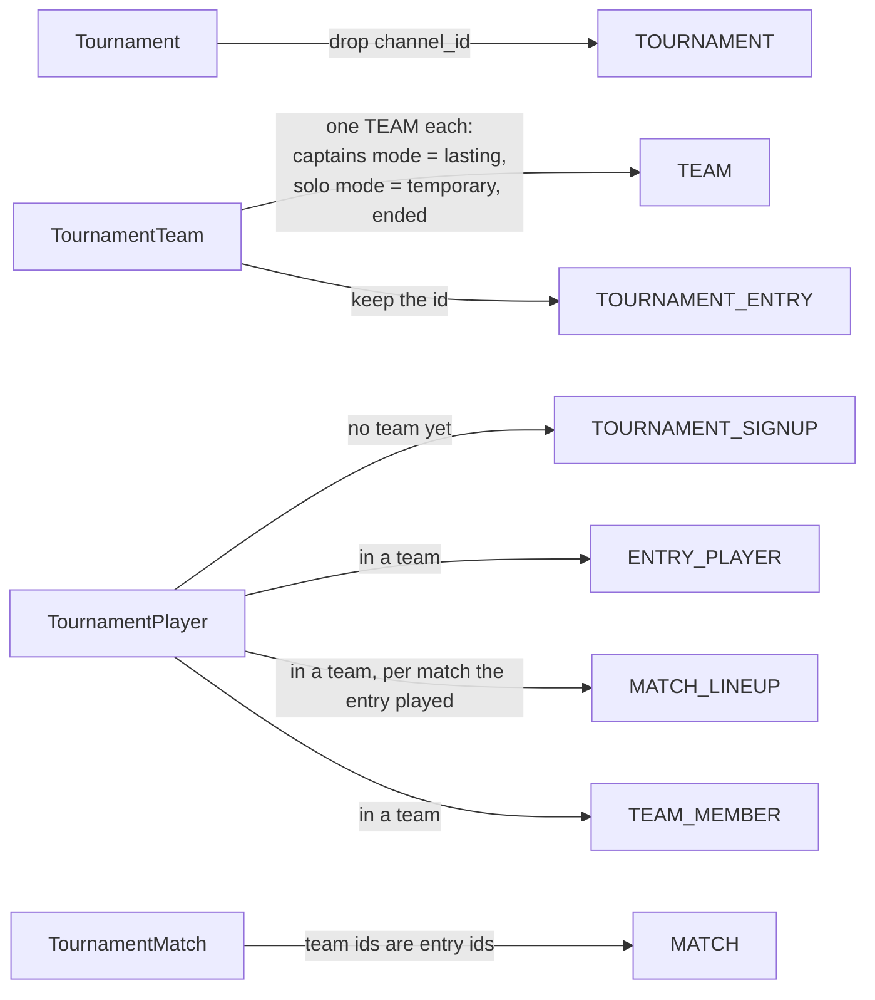

The **Auto-migrate** workflow generates the Alembic revision; the data moves are written by hand in it.

## Branches

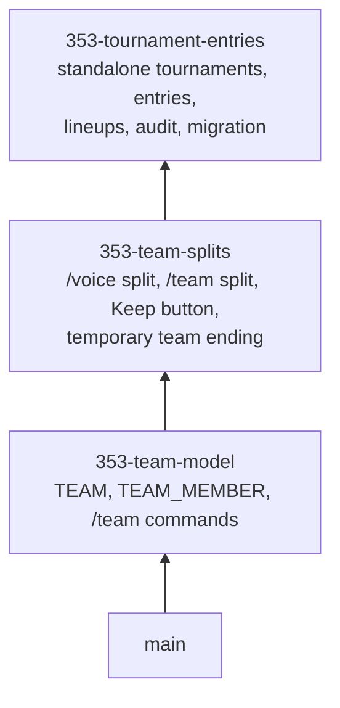

## Parked

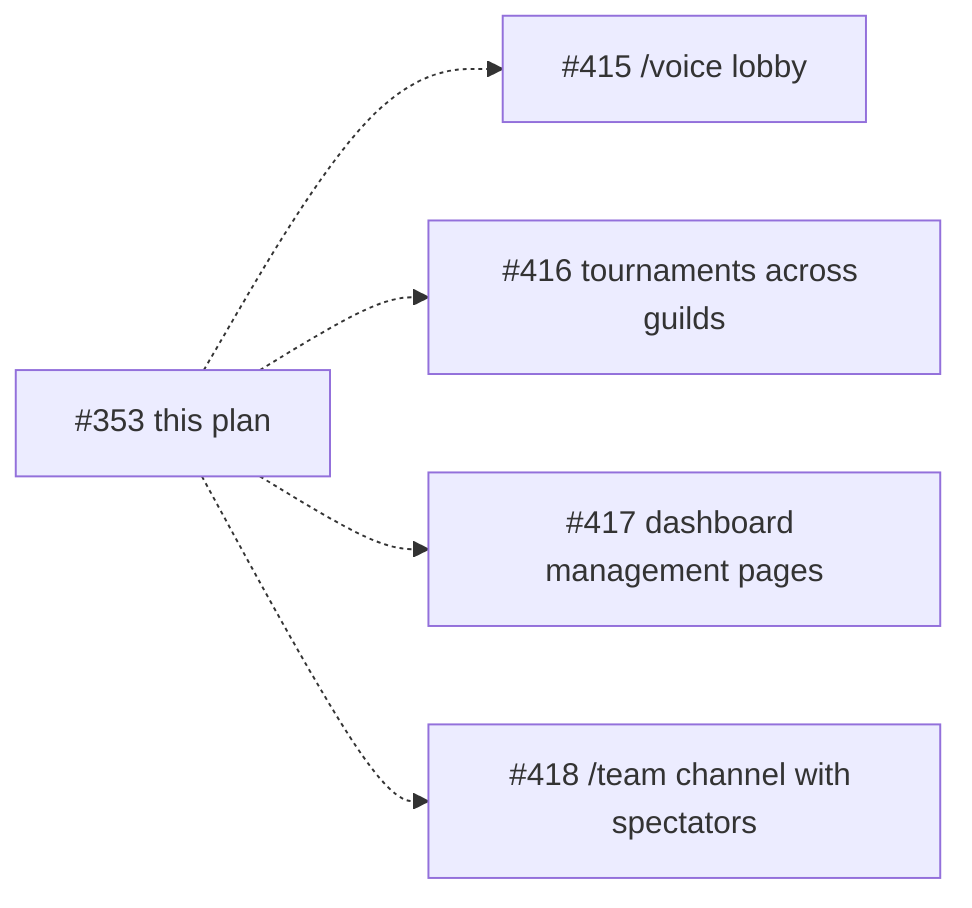

## Match audit

- Every match keeps its frozen `MATCH_LINEUP`, every `LINEUP_CHANGE`, and a `MATCH_EVENT` row for each phase change, draft choice, vote opened or closed, reported winner and forfeit, with who and when.
- The audit points at entries and match lineups, never at a team's current roster. An ended or kept temporary team still shows who played.
- Anyone who can see the tournament sees who played each match and the result. Only the organiser and the entries' captains see the change log.
- When a member's data is deleted, their user id in these rows becomes a deleted-player marker. The rows stay, so brackets and other players' history stay correct.

## Finding and showing a tournament

- Each `/tournament` subcommand takes a `tournament` option. Autocomplete lists the tournaments the member organises or signed up for, and open ones posted in the current channel.
- `/tournament post` puts the tournament's embed in a channel of the tournament's guild and records a `TOURNAMENT_POST`. The bot updates every post. A member needs Manage Messages in that channel.
- The organiser and the guild admins of the tournament's guild run it; a guild admin can do anything the organiser can.
- A lineup only holds members of the tournament's guild. The bot checks at signup and on every lineup change. Mixed-guild lineups wait for #416.
- Buttons on a post carry the tournament id. Anyone who can press signup on any post, or use `/tournament join`, can sign up. The organiser can close signups or remove an entry.
